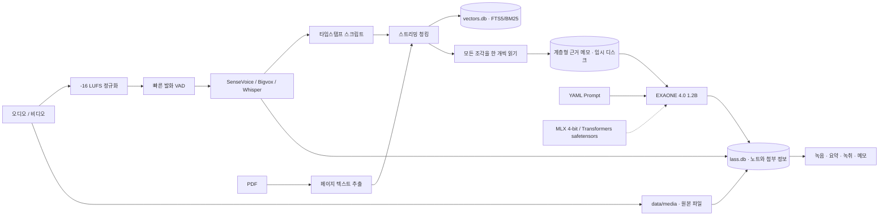

# ✦ LASS — Local AI Study Studio


LASS는 강의, 회의, 인터뷰 녹음을 내 컴퓨터 안에서 텍스트와 학습 노트로
변환하고 계속 관리하는 로컬 AI 강의 워크스페이스입니다. 음성 인식, 검색,
요약, 결과 저장까지 외부 추론 API 없이 처리합니다.

요약 모델은 **LG AI Research EXAONE 4.0 1.2B**입니다. Apple Silicon에서는
`models/exaone-4.0-1.2b-mlx-4bit/`의 4비트 모델을 기본으로 사용하고, 그 밖의
환경에서는 `models/exaone-4.0-1.2b/`의 Transformers 모델을 사용할 수 있습니다.
준비된 요약 모델은 실행 중 Ollama 서버나 Hugging Face 네트워크를 사용하지 않습니다.
STT 모델은 로컬 캐시에 없을 때 최초 사용 시에만 내려받습니다.

## 주요 특징

- **로컬 우선 프라이버시**: 업로드 파일과 생성 결과를 프로젝트의 `data/` 안에서 관리합니다.
- **저메모리 EXAONE 추론**: Apple Silicon에서 MLX 4비트 가중치와 8비트 KV 캐시를 사용합니다.
- **모델 수명 주기 관리**: 다운로드, 상태 조회, SHA-256 무결성 검증 CLI를 제공합니다.
- **긴 강의 STT 안정화**: VAD 전에 BS.1770 통합 음량을 -16 LUFS로 맞추고, 10분이 넘는 녹음은 5분 단위로 문맥을 초기화해 반복 환각이 뒤 구간 전체로 번지는 현상을 줄입니다.
- **SenseVoice Small 기본 STT**: 한국어를 포함한 다국어 SenseVoice Small을 FunASR의 FSMN-VAD와 함께 사용하며, 기존 faster-whisper 모델도 설정에서 계속 선택할 수 있습니다.
- **Bigvox 한국어 STT**: `bigdefence/Bigvox-Exaone4-Audio`를 전용 EXAONE 멀티모달 런타임으로 실행하며, 긴 녹음은 모델 입력 크기에 맞춰 30초씩 처리합니다.
- **사용자 모델 목록**: 설정에서 STT/LLM 프로필을 추가·제거하고 활성 모델을 즉시 바꿀 수 있습니다.
- **두 가지 고대비 테마**: 다크/라이트 모두 선택 컨트롤의 2px 반대색 테두리와 명확한 활성 색을 유지합니다.
- **조절 가능한 워크스페이스**: 자료·AI 패널을 각각 닫거나 다시 열고, 본문/균형/AI 폭 프리셋을 선택합니다.
- **폴더·파일 방식 관리**: 왼쪽에서 폴더를 만들고, 노트나 폴더를 우클릭해 이름 변경·이동·삭제합니다.
- **노트별 분리 보기**: 자료·녹음, 전체 텍스트, 내 메모 중 현재 화면만 렌더링합니다.
- **슬라이드형 PDF 보기**: 파일 선택과 대용량 원본 연결을 제공하며, 스크롤 대신 `이전 장`·`다음 장`으로 한 페이지씩 봅니다.
- **대용량 원본과 바로 녹음**: 큰 녹음·영상을 받고 브라우저 마이크로 즉시 녹음할 수 있습니다.
- **안정적인 Markdown 편집**: AI 요약을 정상 렌더링하고 더블클릭 편집 중 다른 위젯이 바뀌어도 편집 화면을 유지합니다.
- **메모 포함 AI 재요약**: 저장한 내 메모와 수정한 녹취를 함께 참고해 새 요약을 만듭니다.
- **배포용 앱 셸**: Streamlit의 Deploy/개발 툴바를 숨기고 서버를 `127.0.0.1`에만 열어 로컬 프로그램처럼 실행합니다.
- **3단 노트 작업공간**: 왼쪽 탐색, 가운데 자료·녹취·메모, 오른쪽 AI 요약을 동시에 확인하거나 필요한 패널만 남깁니다.
- **폴더 전용 로컬 채팅**: 목록에서는 메타데이터만 읽고, 질문할 때 SQLite에서 노트를 한 건씩 가져와 EXAONE이 답합니다.
- **노트부터 시작**: 빈 노트를 먼저 만들고 메모·여러 녹음·PDF를 나중에 추가합니다.
- **디스크 스트리밍 검색**: 임베딩 모델 대신 SQLite FTS5/BM25를 사용해 검색 데이터가 RAM이 아닌 `vectors.db`에서 커집니다.
- **계층형 전체 요약**: 모든 조각을 하나씩 읽고 근거 메모를 디스크에 쓴 뒤 최대 4개씩 반복 압축합니다. 자료 크기가 늘어도 최종 LLM 입력은 함께 커지지 않습니다.
- **메모리 절약**: 전사·검색·요약을 순차 실행하고, 각 생성 호출과 단계가 끝날 때 입력 객체·모델·GPU 캐시를 해제합니다.
- **데스크톱 실행**: Mac `.app` / Windows `.exe`로 전용 창을 열고, 닫을 때 서버도 종료합니다.
- **교체 가능한 요약 양식**: YAML 프롬프트로 기본 요약, 강의 필기, 회의 액션 아이템을 선택합니다.
- **재사용하는 단일 검색 파일**: 내용 지문이 같은 인덱스는 다시 만들지 않으며, FTS 검색 인덱스를 `vectors.db` 하나에 저장합니다.
- **필요할 때 내보내기**: Markdown은 자동으로 중복 저장하지 않고 다운로드할 때 생성합니다.

## 처리 흐름



## 디렉터리

```text
LASS/
├── models/
│   ├── exaone-4.0-1.2b-mlx-4bit/ # Apple Silicon 기본 4비트 모델
│   └── exaone-4.0-1.2b/      # Transformers 호환 모델
├── scripts/
│   ├── manage_models.py       # download / status / verify
│   └── prune_runtime.py       # 구형 의존성 탐지 및 정리
├── src/
│   ├── llm/                   # EXAONE 로더, 모델 관리자, 프롬프트, 요약기
│   ├── rag/                   # 청킹, SQLite FTS5/BM25 디스크 검색
│   ├── storage/               # SQLite 강의 CRUD 저장소
│   ├── stt/                   # SenseVoice / Bigvox / faster-whisper 음성 인식
│   ├── ui/                    # 가로형 Streamlit 강의 워크스페이스
│   ├── config.py
│   └── pipeline.py
├── prompts/                   # 요약 양식 YAML
├── data/
│   ├── media/                 # 새 녹음·영상·PDF 원본
│   ├── documents/             # 기존 PDF 원본
│   ├── preview/               # 기존 DB 원본의 스트리밍용 복사본
│   ├── logs/                  # 실행·오류 로그
│   ├── lass.db                # 녹음·녹취·요약·메모 기준 저장소
│   ├── model_registry.json    # 사용자 STT/LLM 프로필과 활성 모델
│   └── vectors.db             # 파생 텍스트 검색 인덱스
└── tests/
```

## 설치

### 요구 사항

- Python 3.9 이상(3.10 이상 권장)
- Apple Silicon: MLX 4비트 EXAONE 가중치 약 700MB와 실행 메모리 여유 공간
- 기타 환경: Transformers EXAONE 가중치 약 2.56GB
- 선택 사항: 추가 미디어 변환이 필요할 때 FFmpeg

```bash
git clone https://github.com/your-username/LASS.git
cd LASS

python -m venv .venv
source .venv/bin/activate              # Windows: .venv\Scripts\activate
pip install -r requirements.txt
```

## EXAONE 로컬 모델 준비

공식 모델 스냅샷을 프로젝트 내부로 내려받습니다.

```bash
python scripts/manage_models.py --runtime mlx download       # Apple Silicon
python scripts/manage_models.py --runtime mlx status
# 기타 환경: --runtime transformers
```

다운로드 후 선택한 런타임의 모델 폴더에 다음 자산이 함께 저장됩니다.

- `model.safetensors` — EXAONE 가중치
- `config.json`, `generation_config.json` — 모델 설정
- `tokenizer.json`, `vocab.json`, `chat_template.jinja` — 토크나이저와 대화 템플릿
- `LICENSE`, `README.md` — 원본 라이선스와 모델 카드
- `lass-model-manifest.json` — 파일 크기와 SHA-256 체크섬

무결성 검사는 모든 관리 파일을 다시 해시합니다.

```bash
python scripts/manage_models.py --runtime mlx verify
```

추론 로더는 `local_files_only=True`와 `trust_remote_code=False`를 강제합니다.
따라서 모델 준비 후에는 요약 과정에서 원격 모델 코드나 파일을 가져오지 않습니다.

> 가중치는 용량 때문에 Git에는 커밋하지 않습니다. 현재 작업 폴더에서는 로컬 자산으로
> 관리되며, 다른 장치에서 저장소를 새로 받은 경우 `download`를 한 번 실행해야 합니다.
> 재배포 전에는 모델 폴더의 EXAONE `LICENSE`를 확인하세요.

## 실행

설치가 끝난 배포 폴더에서는 **Mac은 `LASS.app`, Windows는 `LASS.exe` 아이콘을 더블클릭**합니다.
콘솔이나 브라우저 탭 없이 운영체제 WebView의 전용 창만 엽니다. 서버 준비·오류 안내도
창 안에 표시하며, 창을 닫으면 해당 서버를 종료합니다. 다시 아이콘을 누르면 이미 열린
창을 표시하여 AI 서버가 중복 실행되지 않게 합니다. 로그는 `data/logs/`에 있습니다.

개발자가 실행기를 처음 만들 때:

```bash
.venv/bin/python -m pip install 'pyinstaller>=6,<7'
.venv/bin/python scripts/build_desktop.py
# Windows: .venv\Scripts\python.exe scripts\build_desktop.py
```

Windows 실행기는 Windows에서 빌드해야 합니다. `--windowed`로 콘솔을 제거하며,
자식 Python 서버에도 `CREATE_NO_WINDOW`를 적용합니다. Mac은 네이티브 `.app` 번들을 만듭니다.
OS WebView(WebKit / WebView2)를 사용하므로 Electron용 Chromium을 별도로 묶지 않습니다.
Windows에는 WebView2 Runtime이 필요합니다.

**현재 배포 단위는 실행기와 프로젝트 폴더입니다.** 실행기만 다른 폴더로 옮기지 말고
`src/`, `prompts/`, `requirements.txt`, `.streamlit/`, `models/`와 함께 보관하세요.
대형 모델·ML 환경은 실행기에 넣지 않습니다. 최초 실행 시 설치된 Python으로 `.venv`를 만들거나
의존성을 동기화하므로, 사용자에게 배포하기 전 같은 운영체제에서 환경과 모델을 준비하는 것을 권장합니다.
코드 서명 인증서·공증·설치 마법사·자동 업데이트는 포함하지 않습니다.

`LASS.command`와 `LASS.bat`는 개발/초기 준비용 호환 실행기입니다. 일반 사용자는
`.app` / `.exe`를 사용합니다. Linux나 브라우저에서 개발하려면 `./run_lass.sh` 또는
`.venv/bin/python -m streamlit run src/ui/app.py`로 실행할 수 있습니다.

### STT 모델 선택

상단 `설정 → 모델 → STT`에는 SenseVoice Small, Bigvox EXAONE 4 Audio,
faster-whisper가 기본 등록됩니다. `Bigvox · EXAONE 4 Audio`를 선택하면 최초 전사 때
[Bigvox 체크포인트](https://huggingface.co/bigdefence/Bigvox-Exaone4-Audio)를 Hugging Face
캐시에 내려받습니다. 체크포인트는 약 3.87GB이며 Whisper-large-v3 음성 인코더 가중치를
포함하므로, 다운로드 공간 외에도 모델과 중간 텐서를 위한 충분한 RAM/VRAM이 필요합니다.
Bigvox는 한국어 전용이며 타임스탬프를 직접 출력하지 않아 LASS가 30초 처리 구간을
타임라인 구간으로 사용합니다.

### 노트 작성

1. `＋ 노트 추가`를 누르면 모델·파일 없이 빈 노트가 즉시 저장됩니다. 선택한 폴더가 있으면 그 안에 만듭니다.
2. `내 메모`에서 먼저 작성하거나, `자료 · 녹음`에서 파일을 저장합니다. 같은 노트에 여러 녹음·영상·PDF를 붙일 수 있습니다.
3. 큰 파일은 `로컬 파일 경로`에서 `컴퓨터에서 파일 선택`으로 직접 연결합니다. 브라우저 업로드는 200MB까지이며, 직접 연결은 그 제한을 받지 않습니다. 외부 원본의 위치를 유지하세요.
4. 자료를 저장한 뒤 전사/PDF 텍스트 추출을 실행합니다. 요약 모델이 준비되면 `추출 후 전체 노트 요약`도 선택할 수 있습니다.
5. 전사·추출 결과는 요약 전에 저장됩니다. 요약이 실패해도 원본·텍스트·메모는 남고, 재시도 시 전사를 반복하지 않습니다.

원본 미리보기는 요청할 때만 열며 오디오·영상·PDF는 byte range로 스트리밍합니다. PDF는 페이지 폭에 맞춰 열리고 페이지를 이동해도 뷰어와 확대율을 유지합니다.
`자료 · 녹음` / `전체 텍스트` / `내 메모`는 선택한 화면만 렌더링합니다.
AI 요약과 음성 녹취는 더블클릭 편집이 가능하며, 혼합 자료의 음성은 `음성 녹취 수정`에서 편집합니다.
요약 화면에서 저장한 메모를 포함해 다시 요약하거나 Markdown으로 내보낼 수 있습니다.

`data/lass.db`에는 노트·첨부 경로·녹취·요약·메모·폴더 대화를 저장합니다.
새 업로드 원본은 `data/media/`에, 기존 DB 안의 원본은 그대로 유지합니다.
따라서 **백업은 DB만이 아니라 `data/` 전체와 직접 연결한 외부 원본**을 포함해야 합니다.
노트 삭제 시 앱이 관리하는 첨부 파일만 함께 삭제하며 외부 원본은 유지합니다.

### Apple M칩 GPU와 메모리

상단 `설정 → 모델 → 실행 장치`에서 기존 프로필의 장치를 변경할 수 있습니다.
`자동`은 CUDA → Apple GPU(MPS) → CPU 순으로 선택합니다. `Apple M칩 GPU (Metal / MPS)`를 직접 선택해도 됩니다.
SenseVoice는 MPS를 사용할 수 있습니다. 기본 EXAONE은 MLX에서 4비트로 로드하며 KV 캐시는 8비트로 제한합니다.
SenseVoice는 안정성을 위해 FP32를 유지합니다. 지원하지 않는 일부 PyTorch 연산에는 CPU fallback을 허용합니다.
Bigvox는 FP16 체크포인트이며 `자동` 선택 시 CUDA, MPS, CPU 순으로 사용 가능한 장치를 고릅니다.
공식 구현은 CUDA 기준이므로 CPU에서는 실행 시간이 매우 길 수 있습니다.

faster-whisper의 CTranslate2는 Apple GPU를 지원하지 않으므로 Mac에서는 CPU를 사용합니다.
Apple GPU로 전사하려면 SenseVoice를 선택하세요. 기존 모델 선택은 자동으로 바꾸지 않습니다.
근거: [CTranslate2 하드웨어 지원](https://github.com/OpenNMT/CTranslate2/blob/master/docs/hardware_support.md),
[PyTorch MPS](https://docs.pytorch.org/docs/main/mps.html).

16GB 환경을 위한 기본 동작:

- 작업을 한 번에 하나씩 실행하고, 전사 → 검색 → 요약 사이와 실패 시에도 모델을 해제합니다.
- 청크와 FTS 인덱스 행은 작은 배치로 SQLite에 써서 문서 전체 청크·벡터 배열을 RAM에 만들지 않습니다.
- 요약은 모든 조각을 한 개씩 읽습니다. 중간 근거는 디스크에 쓰고 최대 4개씩 계층적으로 압축합니다.
- 폴더 질문은 내용 지문으로 기존 SQLite FTS 인덱스를 재사용하고 관련 조각만 읽습니다. LLM 입력은 기본 2,048 토큰으로 제한합니다.
- 폴더 화면은 제목 등 메타데이터만 불러오고, 채팅 검색 시 전체 노트를 SQLite 커서로 한 건씩 읽습니다.
- SenseVoice는 60초 구간(경계 겹침 포함), 15초 추론 배치로 처리합니다. 음량 분석도 전체 오디오 복사 없이 필터 상태와 400ms 구간 에너지를 계산합니다.
- 브라우저에 원본 전체를 보내지 않고, 자료 업로드·화면·라이브러리 목록의 불필요한 메모리 복사를 줄입니다.

모델을 매번 다시 읽으므로 연속 작업의 시작 시간은 늘 수 있습니다. Apple GPU도 시스템 RAM을 공유합니다.
파일 크기·선택 모델·길이·OS에 따라 최대 사용량이 달라지므로 16GB에서의 고정 RAM 상한을 보장하지는 않습니다.

## 설치 용량 관리

이 저장소의 실행 UI는 Electron/Chromium 번들을 포함하지 않는 Streamlit 앱입니다.
가중치인 `models/`, 사용자 자료인 `data/`, Python 런타임인 `.venv/`는 앱 소스와
분리되어 있으며 실행기 바이너리 내부에 묶지 않습니다. 사용자 배포 폴더에는 준비된 환경과 모델을 함께 둘 수 있습니다. 기존 환경에 ChromaDB나
`sentence-transformers`가 남아 있다면 다음 명령으로 제거 후보와 회수 용량을 먼저
확인한 뒤 정리할 수 있습니다.

```bash
python scripts/prune_runtime.py
python scripts/prune_runtime.py --apply
python -m pip check
```

검색 시 임베딩 모델을 로드하지 않습니다. STT의 BS.1770 음량 측정에 필요한
`pyloudnorm`/SciPy는 유지 대상입니다.
현재 개발 환경에서는 `.venv`가 약 1.1GB에서 966MB로 줄었으며, 모델과 사용자 DB는
삭제하지 않았습니다.

## 환경 변수

| 이름 | 기본값 | 설명 |
|---|---|---|
| `LASS_EXAONE_MODEL_ID` | `LGAI-EXAONE/EXAONE-4.0-1.2B` | 매니페스트에 기록할 공식 모델 ID |
| `LASS_EXAONE_MODEL_DIR` | `./models/exaone-4.0-1.2b` | 프로젝트 로컬 모델 경로 |
| `LASS_EXAONE_MLX_MODEL_ID` | `mlx-community/exaone-4.0-1.2b-4bit` | Apple Silicon 4비트 모델 ID |
| `LASS_EXAONE_MLX_MODEL_DIR` | `./models/exaone-4.0-1.2b-mlx-4bit` | Apple Silicon 4비트 모델 경로 |
| `LASS_EXAONE_DEVICE` | `auto` | `auto`, `cuda`, `mps`, `cpu` |
| `LASS_EXAONE_MAX_INPUT_TOKENS` | `2048` | 요약 입력 토큰 상한(512~32768) |
| `LASS_EXAONE_MAX_NEW_TOKENS` | `384` | 요약 최대 생성 토큰 수 |
| `LASS_EXAONE_TEMPERATURE` | `0.1` | 한국어 생성 안정성을 위한 낮은 기본 온도 |
| `LASS_WHISPER_MODEL` | `large-v3` | 함께 유지되는 faster-whisper 모델 또는 로컬 경로 |
| `LASS_STT_TARGET_LUFS` | `-16` | VAD 전에 적용할 BS.1770 통합 음량 목표(-30~-5) |
| `LASS_EMBEDDING_MODEL` | `intfloat/multilingual-e5-small` | 기존 벡터 인덱스 호환 설정(새 FTS 경로에서는 로드하지 않음) |
| `LASS_CHUNK_SIZE` | `1200` | 스크립트 청크 크기 |
| `LASS_CHUNK_OVERLAP` | `150` | 청크 간 중첩 길이 |

## 프롬프트 커스터마이징

`prompts/`의 YAML 파일에서 요약 목적을 수정하거나 새 양식을 추가할 수 있습니다.
각 파일에는 반드시 `{context}`가 포함된 `user_prompt`가 있어야 합니다.

```yaml
name: "강의 상세 노트"
description: "개념과 예시를 구조화한 학습 노트"
system_prompt: |
  당신은 학습자가 복습하기 좋은 한국어 노트를 만드는 조교입니다.
user_prompt: |
  다음 강의 내용을 구조화해 주세요:
  {context}
```

## 테스트

```bash
python -m unittest discover -s tests -v
python scripts/manage_models.py verify
```

코드 라이선스는 MIT입니다. EXAONE 모델 가중치에는 모델 폴더에 포함된 별도
EXAONE 라이선스가 적용됩니다.
